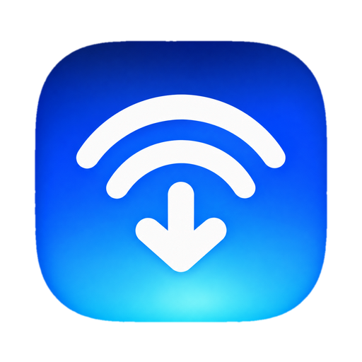
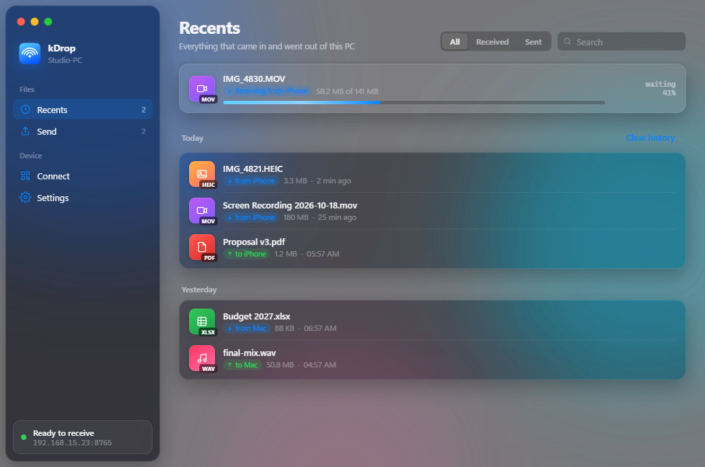
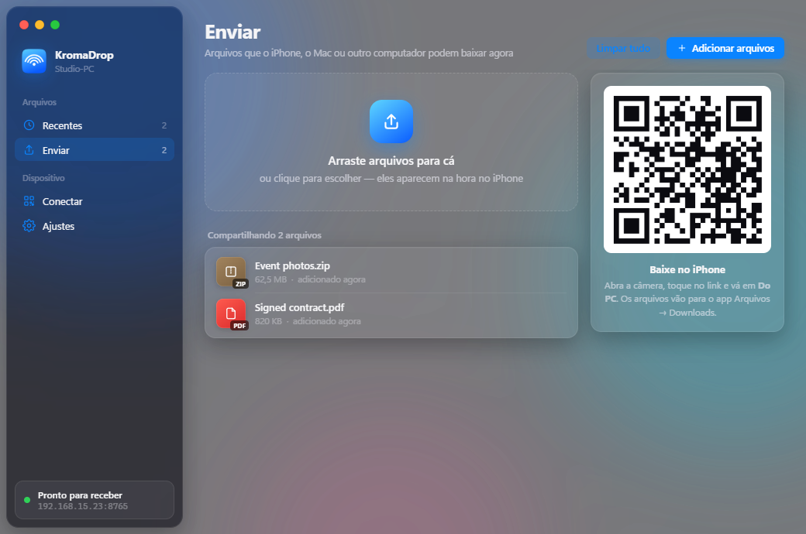
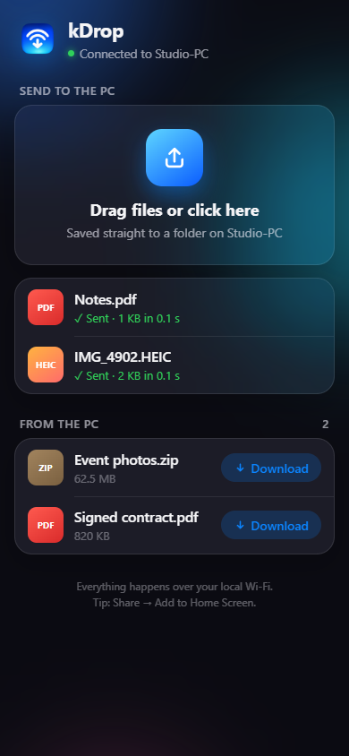
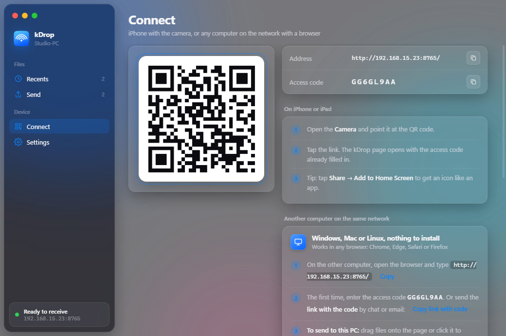
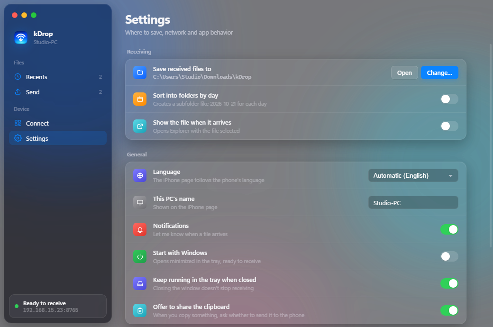

<p align="center">
  
</p>

<h1 align="center">KromaDrop</h1>

<p align="center">
  <b>AirDrop-style file sharing for Windows: send to and from iPhone, Mac and any computer on your Wi-Fi.</b><br>
  Scan a QR code and drop files in both directions. Nothing to install on the other device,<br>
  no account, no cloud. Your files never leave your network.
</p>

<p align="center">
  
  
  
  
  
</p>

<p align="center">
  <a href="#features"><b>Features</b></a> ·
  <a href="#how-it-works">How it works</a> ·
  <a href="#how-fast-is-it">Speed</a> ·
  <a href="#get-started">Get started</a> ·
  <a href="#send-from-the-iphone-share-sheet">Share sheet shortcut</a> ·
  <a href="#troubleshooting">Troubleshooting</a> ·
  <a href="README.pt-BR.md">Português</a>
</p>

<p align="center">
  
  <br>
  <sub>Recents: everything that came in and went out, grouped by day, with live progress and speed.</sub>
</p>

<table>
  <tr>
    <td width="25%" valign="top">
      <h3>📱 Nothing to install</h3>
      The iPhone, Mac or other PC just opens a web page. Point the camera at the QR code and you're connected.
    </td>
    <td width="25%" valign="top">
      <h3>⇅ Both directions</h3>
      Phone to PC, PC to phone, PC to PC. Drag files onto the window and they show up on the other device at once.
    </td>
    <td width="25%" valign="top">
      <h3>⚡ As fast as your Wi-Fi</h3>
      Files stream straight from device to device. On a good 5 GHz network it's on par with AirDrop.
    </td>
    <td width="25%" valign="top">
      <h3>🔒 Stays at home</h3>
      Nothing goes through the internet. Every request needs an 8-character access code, built into the QR code.
    </td>
  </tr>
</table>

> [!NOTE]
> The app's interface is in Brazilian Portuguese for now. Translations are welcome.

## Features

<table>
  <tr>
    <td width="50%" valign="top">
      
      <br>
      <sub>Two files shared with the iPhone, ready to download.</sub>
      <h3>Send from the PC</h3>
      Drag files anywhere onto the window, or press <b>Ctrl+O</b>. They appear instantly under <b>From the PC</b> on every connected phone or computer, with no refresh needed. On the iPhone, <b>Download</b> saves to Files → Downloads.
      <br><br>
      Shared files stay available until you remove them. KromaDrop serves them straight from where they are on disk, without copying them.
    </td>
    <td width="50%" valign="top">
      
      <br>
      <sub>The page the iPhone opens: no App Store, no install.</sub>
      <h3>Receive from the iPhone</h3>
      Tap <b>Choose photos or files</b> to pick from Photos, the camera or the Files app. Each upload shows its progress and speed, and lands in the folder you chose on the PC with a Windows notification.
      <br><br>
      Add the page to the Home Screen and it opens like an app.
    </td>
  </tr>
  <tr>
    <td width="50%" valign="top">
      
      <br>
      <sub>Connect: one QR code for the iPhone, one address for every other computer.</sub>
      <h3>Connect in one scan</h3>
      The QR code carries the address and the access code, so the iPhone is connected the moment you tap the link. Any other computer on the network (Windows, Mac or Linux) opens the same address in a browser and drags files onto the page.
      <br><br>
      If the PC has several networks (Wi-Fi, Ethernet, VPN), you pick which one the code points to. The code updates by itself when the IP changes.
    </td>
    <td width="50%" valign="top">
      
      <br>
      <sub>Settings, grouped like macOS System Settings.</sub>
      <h3>Your folder, your rules</h3>
      Choose where received files are saved, and optionally sort them into one folder per day. Get a notification or have Explorer show each file as it arrives.
      <br><br>
      Start with Windows straight to the tray, keep receiving after you close the window, change the port, or generate a new access code to disconnect every device at once.
    </td>
  </tr>
</table>

### Works with

| Device | How it connects | Send to the PC | Receive from the PC |
|---|---|:---:|:---:|
| iPhone / iPad | Camera → QR code (Safari) | ✅ | ✅ |
| iPhone share sheet | Shortcuts app ([setup](#send-from-the-iphone-share-sheet)) | ✅ | — |
| Mac | Safari, Chrome or any browser | ✅ drag & drop | ✅ |
| Windows / Linux PC | Any browser | ✅ drag & drop | ✅ |
| Android | Any browser | ✅ | ✅ |

## How it works

```
 iPhone / Mac / other PC                         Windows PC running KromaDrop
 ┌────────────────────┐   same Wi-Fi / router   ┌──────────────────────────────┐
 │  Safari / browser  │ ──── HTTP upload ─────▶ │  local server (port 8765)    │──▶ your folder
 │  KromaDrop page    │ ◀─── HTTP download ──── │  shared files list           │◀── drag & drop
 │                    │ ◀─── live updates ───── │  (Server-Sent Events)        │
 └────────────────────┘                         └──────────────────────────────┘
```

KromaDrop runs a small web server on your PC that only your local network can reach. The phone or computer opens its page, and files stream straight between the two devices, with nothing in the middle.

**Why doesn't the PC show up in the iPhone's AirDrop list?** AirDrop runs on AWDL, a private Apple Wi-Fi protocol that standard Windows Wi-Fi drivers can't speak. KromaDrop gets you the same result over your normal network, and the share sheet shortcut puts **Send to PC** right next to AirDrop.

## How fast is it?

Files go device → router → PC, so speed depends on your network, not on KromaDrop.

| Network | Typical speed | 1 GB video |
|---|---|---|
| Wi-Fi 4 (2.4 GHz) | 3–8 MB/s | 2–5 min |
| Wi-Fi 5 (5 GHz), both devices on Wi-Fi | 15–35 MB/s | 30–70 s |
| Wi-Fi 5 (5 GHz), **PC on Ethernet** | 30–60 MB/s | 17–35 s |
| Wi-Fi 6/6E, **PC on Ethernet** | 60–110 MB/s | 10–17 s |

The single biggest win is plugging the PC into the router with a cable.

## Get started

You need [Node.js](https://nodejs.org/) 20 or newer on Windows 10 or 11.

```bash
git clone https://github.com/Kromaverso/k-drop.git
cd k-drop
npm install
npm start          # run the app
npm run dist       # build a Windows installer into dist/
```

The first time it runs:

1. **Windows Firewall** asks about KromaDrop. Allow it on **Private networks**.
2. Make sure your Wi-Fi is set to **Private** in *Settings → Network & internet → Wi-Fi*. On a Public network, Windows blocks incoming connections.
3. Open **Conectar** (Connect) and scan the QR code with the iPhone camera.

The see-through glass background needs Windows 11 22H2 or newer. On older versions the app still works, without the blur.

## Send from the iPhone share sheet

Create the shortcut once and **Send to PC** appears in the share sheet of every app, right below AirDrop. The **Connect** screen shows these steps with your real address and a copy button.

1. In **Shortcuts**, tap **+**. Under **ⓘ Details**, turn on **Show in Share Sheet** and accept **Images, Media and Files**.
2. Add **Repeat with Each** over the **Shortcut Input**.
3. Inside the loop, add **Get Contents of URL** with `http://<pc-ip>:8765/api/upload?t=<code>&name=`, then append the variables **Repeat Item → Name**, a dot, and **Repeat Item → File Extension**.
4. Under **Show More**, set Method to **POST** and Request Body to **File → Repeat Item**.
5. Name it **Send to PC**.

The QR code updates when the PC's IP changes, but the shortcut keeps the old address. Reserve a fixed IP for the PC in your router (a DHCP reservation) so the shortcut always works.

## Troubleshooting

| Symptom | Fix |
|---|---|
| The page doesn't open on the iPhone | Same Wi-Fi? Network set to **Private** on the PC? Firewall allowed? Guest networks often isolate devices from each other. |
| It worked, then stopped | The PC's IP probably changed. Scan the new QR code, and set a DHCP reservation in the router. |
| "Invalid access code" | The code was regenerated in Settings. Scan the QR code again. |
| Slow transfers | Use 5 GHz instead of 2.4 GHz, move closer to the router, or connect the PC by cable. Turn off VPNs. |
| Port already in use | Pick another port under **Ajustes → Porta**. |

Transfers are logged to `%APPDATA%\KromaDrop\kromadrop.log`. Include that file when you open an issue.

## Under the hood

- **Electron app** with a frameless window, custom traffic-light controls and the Windows 11 acrylic backdrop. It lives in the tray and can start with Windows.
- **Plain Node HTTP server** with no web framework. Uploads stream straight to disk with no size limit, downloads support HTTP Range so they can resume, and the shared list reaches every device live over Server-Sent Events.
- **One self-contained page** for phones and other computers (HTML, CSS and JS in one file), installable to the Home Screen.
- **No database**: settings, history and the shared list live in one JSON file in `%APPDATA%\KromaDrop`.

| Endpoint | What it does |
|---|---|
| `GET /` | The page for phones and other computers |
| `POST /api/upload?name=` | Upload a file (raw request body) |
| `GET /api/info` | PC name and shared files |
| `GET /api/events` | Live updates to the shared list (SSE) |
| `GET /api/outbox/:id` | Download a shared file (supports Range) |

Every `/api` call needs the access code, sent in the `X-Token` header or as `?t=`.

```
src/
├── main.js            window, tray, notifications, IPC
├── server.js          HTTP server: uploads, downloads, SSE
├── store.js           settings, history, shared list (JSON)
├── preload.js         safe bridge between the window and the app
├── renderer/          the Windows interface
└── mobile/            the page for iPhone, Mac and other PCs
tools/
├── make-icon.js       draws the app and tray icons (no dependencies)
└── capture.js         renders the screenshots in this README
```

To refresh the screenshots with sample data in an isolated profile, run `npx electron .` with the environment variable `KD_CAPTURE=<folder>` set.

## Security

- Only devices on your local network can reach KromaDrop, and every request needs the access code.
- The code is 8 random characters. Generating a new one in Settings disconnects every device right away.
- Uploaded file names are cleaned up, so files can't escape the folder you chose or overwrite each other.
- Traffic is plain HTTP inside your network. Use KromaDrop on networks you trust, not on public Wi-Fi.

---

<p align="center">
  <sub>Made by <a href="https://github.com/Kromaverso">Kromaverso</a>. AirDrop is a trademark of Apple Inc. KromaDrop is not affiliated with or endorsed by Apple.</sub>
</p>
